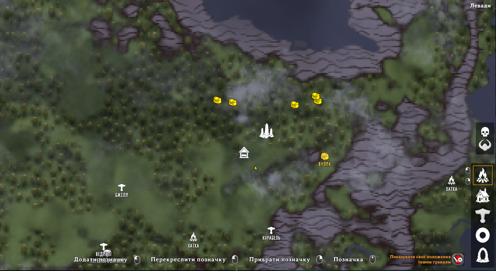
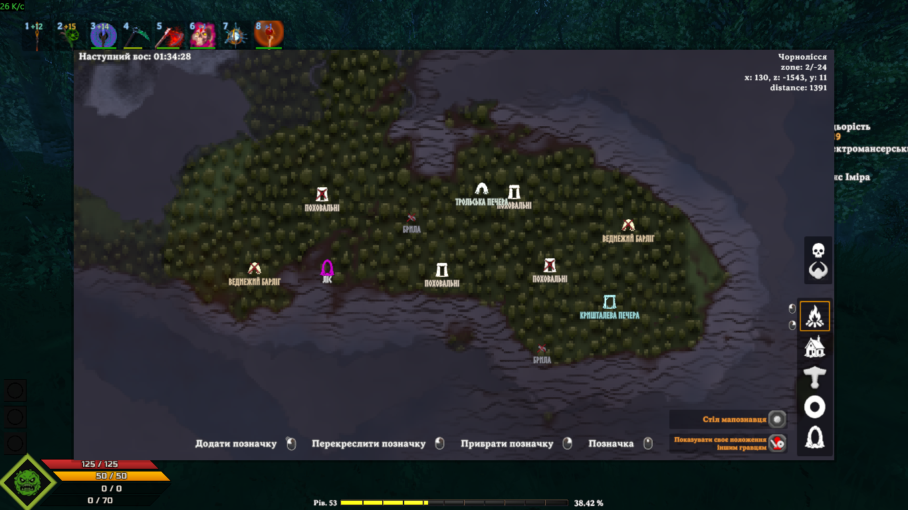
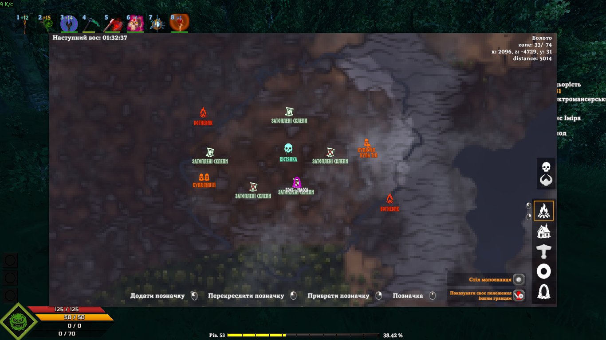

# AutoMapPins

**Automatically mark useful places and resources as you explore Valheim.**

AutoMapPins adds pins for ore deposits, dungeons, chests, wild beehives, and other configured objects. Choose what appears on your map and which discoveries you want to keep.

## Features

- **Automatic map pins** — mark nearby objects on the map and minimap in explored areas.
- **Choose your categories** — enable the resources and locations you care about.
- **Temporary or permanent** — show nearby objects while exploring, or save discoveries with your character.
- **Custom icons** — use the included Cartur artwork or your own PNGs; adjust colors and map icon sizes.
- **Pin grouping** — combine nearby objects into one marker with a count.
- **Live configuration** — reload category, icon, and PNG changes without restarting the game.
- **Optional skill integration** — set Exploration level requirements and follow discovery-radius changes from compatible skill mods.
- **Server configuration sync** — use the server's category settings in multiplayer.

## In-game preview







[Gallery / Галерея](https://github.com/GrandpaUA/AutoMapPins/blob/main/docs/SCREENSHOTS.md).

## Installation

Install with a Valheim mod manager, or copy the package's `plugins` and `config` folders into `BepInEx`.

Requires **BepInExPack Valheim**. The optional mods below are not required for normal use.

## Configuration

The included setup by **BioHazardN7** has **94 categories: 62 enabled and 32 disabled**. Enable only what you want to see on your map.

Settings are in `BepInEx/config`:

| File | What to change |
| --- | --- |
| `FixItFelix.AutoMapPins.cfg` | General options and discovery radius |
| `FixItFelix.AutoMapPins.categories.yaml` | Active categories, names, grouping, permanent pins, and skill requirements |
| `FixItFelix.AutoMapPins.icons.yaml` | PNG paths, icon sizes, and replacements for game map icons |

Use `isActive: true` or `false` to toggle a category. See the [configuration guide](https://github.com/GrandpaUA/AutoMapPins/blob/main/docs/CONFIGURATION.md) for examples and the [icon guide](https://github.com/GrandpaUA/AutoMapPins/blob/main/docs/ICONS.md) for custom images.

### Category example

Edit an existing category in `FixItFelix.AutoMapPins.categories.yaml` to control its objects and behavior:

```yaml
Ore_Copper:
  categoryConfiguredObjects:
    - rock4_copper
    - rock4_copper_frac
  name: $item_copper
  iconName: Ore_Copper
  isActive: true
  isPermanent: false
  groupable: true
  skillRequire: 20
```

| Setting | Effect |
| --- | --- |
| `isActive` | Enable or disable this category/object |
| `isPermanent` | Save discovered pins with the character instead of showing them only nearby |
| `groupable` / `groupingDistance` | Combine nearby objects and set the grouping distance |
| `name` | Map label; game localization keys such as `$item_copper` are supported |
| `iconName` / `iconColorRGBA` | Choose the icon and its RGBA color |
| `skillRequire` | Exploration level required for new discoveries, from 0 to 100 |

Use `individualConfiguredObjects` when particular objects need their own settings. The [configuration guide](docs/CONFIGURATION.md) explains inheritance, additional files, and the complete YAML schema.

### Updating an existing profile

1. Back up the character save and all AMP category/icon YAML before switching presets.
2. Move the old preset outside `BepInEx/config` so its entries do not merge with the new preset. An existing `FixItFelix.AutoMapPins.categories.vanilla.yaml` takes precedence over `categories.yaml`.
3. Install the new category/icon files and their PNGs together, retaining the paths used by the icon YAML.
4. Check the game log and your map before continuing with the main save. Explicit category disable/permanence changes can remove saved AMP pins.

Additional category files use names such as `FixItFelix.AutoMapPins.categories.mods.yaml` and can be placed in config subfolders. Avoid configuring the same object in multiple files unless you intend to override it. The previous vanilla-focused preset is included in `BepInEx/plugins/AutoMapPins/presets/Vanilla`.

To roll back policy changes, restore the original configuration and character backup together. See [upgrade and rollback notes](docs/COMPATIBILITY.md#upgrade-and-rollback).

## Optional mods

The supplied configuration includes entries for:

| Mod | Configured objects |
| --- | --- |
| **Smoothbrain Jewelcrafting** | Gemstone deposits, crystal caves, and gacha locations |
| **Therzie Wizardry** | Witcheye, Deathcap, Wizardbutter, and Devilstongue mushrooms |
| **Therzie Monstrum** | Asmodeus, Svalt, and Vrykolathas altars and vegvisirs |

Some of these categories are off by default. Objects from mods you do not have simply do not appear. See the [compatibility notes](https://github.com/GrandpaUA/AutoMapPins/blob/main/docs/COMPATIBILITY.md) for scope and version verification.

**Exploration** can gate new discoveries by skill level; requirements are ignored if it is absent. **Sailing** can contribute to the exploration radius. Already discovered permanent pins survive skill loss.

## Custom icons

The package includes 82 PNGs by Cartur. Icon names are defined separately from category settings, so several categories can reuse the same picture.

For a custom image, place the PNG under `BepInEx/config` and reference its relative path:

```yaml
icons:
  customOre:
    file: "AutoMapPins/icons/custom_ore.png"
    fallbackIcon: "mine48"
    size: 125
```

Then set the category's `iconName` to `customOre`. `size` is the map display percentage: 100 is normal, 125 is 1.25 times normal, and the allowed range is 1–300. It does not resize the PNG file.

`vanillaOverrides` can replace game map pin types such as `Death`, `Bed`, and `Icon0`, or exact location IDs such as `Vendor_BlackForest` and `Hildir_camp`. Matching vanilla picker buttons can use the replacement image too. `None` is excluded; location keys do not create new pins or activate AMP categories.

YAML and PNG edits reload while the game is running. An unreadable PNG keeps that entry's last working image and size for the current session; valid entries can still update. After a restart, a missing image uses its configured fallback where available. See [icon loading, overrides, and built-in names](docs/ICONS.md).

## Skills and discovery radius

With Exploration installed, `skillRequire` gates new discoveries by the player's level. A category can set the threshold and an individual object can override it. Temporary pins disappear below the threshold and return when it is reached again. Permanent discoveries already earned survive skill loss. Without Exploration, the requirements are ignored.

The standard preset uses thresholds, including 20 for copper and 75 for silver. Exploration/Sailing can also change the observed exploration radius. AMP follows the effective radius but does not make distant objects load or generate new zones. The separate generated-zone scanner is experimental and disabled by default.

## Multiplayer configuration

For server-managed settings, install the same AMP version on the server and clients. Category settings are synchronized from the server. Install the icon YAML and PNGs on each client too: category synchronization does not transfer the image files.

AMP-generated pins remain personal and are excluded from cartography-table sharing. Regular game map data still shares normally. Experimental generated-zone multiplayer scanning has additional requirements and is not yet field-verified; see the [experimental guide](docs/EXPERIMENTAL-SCANNING.md).

## Console commands

| Command | Purpose |
| --- | --- |
| `amp print_effective_config <object name>` | Show the effective settings of an object |
| `amp scan [radius] [all]` | Summarize loaded object IDs, counts, and nearest distances; default 30 m, allowed 1–100 m |
| `amp scan_nearby [radius] [all]` | Inspect nearby loaded objects/components |
| `amp write_missing_configs_file` | Write collected unconfigured objects as a YAML starting point |
| `amp clear_pins` | Remove AMP pins, including permanent/saved AMP metadata; preserve other map markers |

Use `all` to include child objects, for example `amp scan 30 all` near a Vegvisir. The `amp scan` summary has bounded output. Both scanning commands are local diagnostics and cannot find unloaded or ungenerated objects. Collecting unknown objects requires `Enable the prefab discovery` in the main config. Back up your save before clearing pins or changing permanent policies.

## Documentation and development

- [Configuration reference and YAML examples](docs/CONFIGURATION.md).
- [Custom icons and the built-in icon table](docs/ICONS.md).
- [Optional-mod compatibility and migration](docs/COMPATIBILITY.md).
- [Experimental distant scanning](docs/EXPERIMENTAL-SCANNING.md).
- [Build and regression-check commands](BUILD.md) and [contribution guidance](CONTRIBUTING.md).
- [Candidate acceptance checks](docs/RELEASE.md) and [package verification](scripts/PACKAGING.md).
- [Short Thunderstore overview](ThunderStorePackage/README.md).

The source regression suites compile production code against runtime stubs. They are useful for detecting regressions but do not replace testing the exact DLL in Valheim. Full source, artwork provenance, and dependency notices remain available alongside the mod.

## Good to know

- Normal discovery uses loaded objects in explored areas. Increasing the radius does not generate distant zones.
- Permanent discoveries stay saved until removed or changed by your configuration.
- AMP pins are not shared through the cartography table.
- [Previously generated-zone scanning](https://github.com/GrandpaUA/AutoMapPins/blob/main/docs/EXPERIMENTAL-SCANNING.md) is experimental and off by default. Its multiplayer behavior still needs field testing.

**Current build: 2.3.17 release candidate.** Full in-game acceptance is still tracked in [release checks](https://github.com/GrandpaUA/AutoMapPins/issues/1).

## Bugs, questions, and ideas

Use [GitHub Issues](https://github.com/GrandpaUA/AutoMapPins/issues/new/choose) for all reports and questions. English and Ukrainian are welcome. For bugs, include your mod/game versions, reproduction steps, relevant config, and `BepInEx/LogOutput.log`.

## Support development

If the mod is useful to you, you can support its development:

[](https://ko-fi.com/grandpa_ai)

## Credits

- Original mod: [FixItFelix](https://github.com/FelixReuthlinger/AutoMapPins); compatibility work: [littlebeagle](https://github.com/littlebeagle/AutoMapPins).
- Maintained continuation: [GrandpaUA](https://github.com/GrandpaUA).
- Testing and supplied configuration: **BioHazardN7**.
- Additional icon artwork: **Cartur**, author of [Cartur's Map Pins](https://thunderstore.io/c/valheim/p/Cartur/Carturs_Map_Pins/). The images are included; installing Cartur's separate mod is not required.

[Full artwork credits](https://github.com/GrandpaUA/AutoMapPins/blob/main/ThunderStorePackage/plugins/AutoMapPins/licenses/CREDITS.md) · [Source](https://github.com/GrandpaUA/AutoMapPins) · [Changelog](https://github.com/GrandpaUA/AutoMapPins/blob/main/CHANGELOG.md) · [Українською](https://github.com/GrandpaUA/AutoMapPins/blob/main/docs/README.uk.md) · Code license: LGPLv3.
