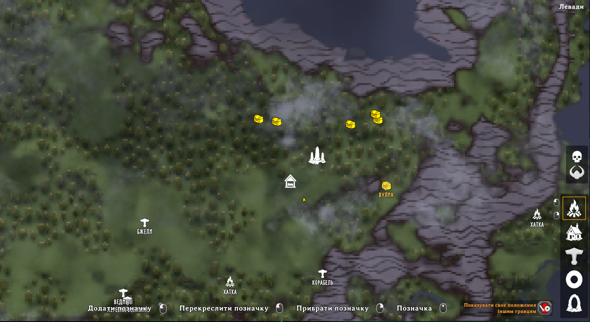

# AutoMapPins

**Automatically mark useful places and resources as you explore Valheim.**

AutoMapPins adds pins for ore deposits, dungeons, chests, wild beehives, and other configured objects. Choose what appears on your map and which discoveries you want to keep.

## Features

- **Automatic map pins** — mark nearby objects on the map and minimap in explored areas.
- **Choose your categories** — enable the resources and locations you care about.
- **Temporary or permanent** — show nearby objects while exploring, or save discoveries with your character.
- **Custom icons** — use the included Cartur artwork or your own PNGs; adjust colors and map icon sizes.
- **Pin grouping** — combine nearby objects into one marker with a count.
- **Live configuration** — reload category, icon, and PNG changes without restarting the game.
- **Optional skill integration** — set Exploration level requirements and follow discovery-radius changes from compatible skill mods.
- **Server configuration sync** — use the server's category settings in multiplayer.

## In-game preview

## Installation

Install with a Valheim mod manager, or copy the package's `plugins` and `config` folders into `BepInEx`.

Requires **BepInExPack Valheim**. The optional mods below are not required for normal use.

## Configuration

The included setup by **BioHazardN7** has **94 categories: 62 enabled and 32 disabled**. Enable only what you want to see on your map.

Settings are in `BepInEx/config`:

| File | What to change |
| --- | --- |
| `FixItFelix.AutoMapPins.cfg` | General options and discovery radius |
| `FixItFelix.AutoMapPins.categories.yaml` | Active categories, names, grouping, permanent pins, and skill requirements |
| `FixItFelix.AutoMapPins.icons.yaml` | PNG paths, icon sizes, and replacements for game map icons |

Use `isActive: true` or `false` to toggle a category. See the [configuration guide](https://github.com/GrandpaUA/AutoMapPins/blob/main/docs/CONFIGURATION.md) for examples and the [icon guide](https://github.com/GrandpaUA/AutoMapPins/blob/main/docs/ICONS.md) for custom images.

**Updating an existing setup?** Back up your character save and AMP configuration first. Changing active/permanent policies can remove saved AMP pins. An old `categories.vanilla.yaml` takes precedence over `categories.yaml`; see the [upgrade notes](https://github.com/GrandpaUA/AutoMapPins/blob/main/docs/COMPATIBILITY.md#upgrade-and-rollback) before switching presets.

## Optional mods

The supplied configuration includes entries for:

| Mod | Configured objects |
| --- | --- |
| **Smoothbrain Jewelcrafting** | Gemstone deposits, crystal caves, and gacha locations |
| **Therzie Wizardry** | Witcheye, Deathcap, Wizardbutter, and Devilstongue mushrooms |
| **Therzie Monstrum** | Asmodeus, Svalt, and Vrykolathas altars and vegvisirs |

Some of these categories are off by default. Objects from mods you do not have simply do not appear. See the [compatibility notes](https://github.com/GrandpaUA/AutoMapPins/blob/main/docs/COMPATIBILITY.md) for scope and version verification.

**Exploration** can gate new discoveries by skill level; requirements are ignored if it is absent. **Sailing** can contribute to the exploration radius. Already discovered permanent pins survive skill loss.

## Good to know

- Normal discovery uses loaded objects in explored areas. Increasing the radius does not generate distant zones.
- Permanent discoveries stay saved until removed or changed by your configuration.
- AMP pins are not shared through the cartography table.
- [Previously generated-zone scanning](https://github.com/GrandpaUA/AutoMapPins/blob/main/docs/EXPERIMENTAL-SCANNING.md) is experimental and off by default. Its multiplayer behavior still needs field testing.

**Current build: 2.3.17 release candidate.** Full in-game acceptance is still tracked in [release checks](https://github.com/GrandpaUA/AutoMapPins/issues/1).

## Bugs, questions, and ideas

Use [GitHub Issues](https://github.com/GrandpaUA/AutoMapPins/issues/new/choose) for all reports and questions. English and Ukrainian are welcome. For bugs, include your mod/game versions, reproduction steps, relevant config, and `BepInEx/LogOutput.log`.

## Support development

If the mod is useful to you, you can support its development:

## Credits

- Original mod: [FixItFelix](https://github.com/FelixReuthlinger/AutoMapPins); compatibility work: [littlebeagle](https://github.com/littlebeagle/AutoMapPins).
- Maintained continuation: [GrandpaUA](https://github.com/GrandpaUA).
- Testing and supplied configuration: **BioHazardN7**.
- Additional icon artwork: **Cartur**, author of [Cartur's Map Pins](https://thunderstore.io/c/valheim/p/Cartur/Carturs_Map_Pins/). The images are included; installing Cartur's separate mod is not required.

[Full artwork credits](https://github.com/GrandpaUA/AutoMapPins/blob/main/ThunderStorePackage/plugins/AutoMapPins/licenses/CREDITS.md) · [Source](https://github.com/GrandpaUA/AutoMapPins) · [Changelog](https://github.com/GrandpaUA/AutoMapPins/blob/main/CHANGELOG.md) · [Українською](https://github.com/GrandpaUA/AutoMapPins/blob/main/ThunderStorePackage/README.uk.md) · Code license: LGPLv3.
