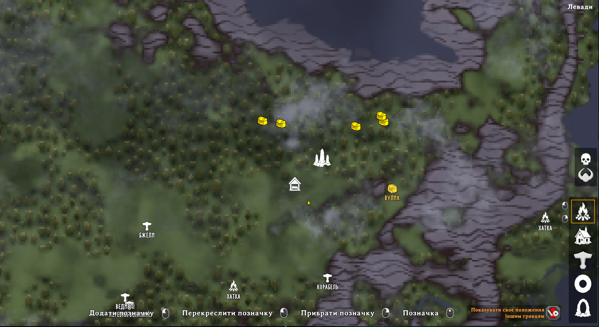

# AutoMapPins

**Автоматично позначай корисні місця й ресурси, досліджуючи світ Valheim.**

AutoMapPins додає позначки родовищ руди, підземель, скринь, диких вуликів та інших налаштованих об’єктів. Обирай, що показувати на мапі та які відкриття зберігати.

## Можливості

- **Автоматичні позначки** — об’єкти поблизу з’являються на мапі й мінімапі в досліджених областях.
- **Вибір категорій** — увімкни лише потрібні ресурси та локації.
- **Тимчасові або постійні позначки** — переглядай об’єкти поблизу чи зберігай відкриття разом із персонажем.
- **Кастомні іконки** — використовуй зображення Cartur або власні PNG, змінюй кольори й розміри позначок.
- **Групування** — об’єднуй сусідні об’єкти в одну позначку з їх кількістю.
- **Оновлення без перезапуску** — зміни категорій, іконок та PNG підхоплюються під час гри.
- **Інтеграція з навичками** — задай потрібний рівень Exploration і використовуй зміни радіуса дослідження від сумісних модів.
- **Серверні налаштування** — синхронізуй налаштування категорій із сервером.

## Вигляд у грі

## Установлення

Установи мод через менеджер модів Valheim або скопіюй папки `plugins` і `config` із пакета до `BepInEx`.

Потрібен **BepInExPack Valheim**. Перелічені нижче сторонні моди для звичайної роботи не обов’язкові.

## Налаштування

До мода входить конфігурація **BioHazardN7**: **94 категорії — 62 ввімкнені, 32 вимкнені**. Залиш активними лише ті, які хочеш бачити на мапі.

Файли розташовані в `BepInEx/config`:

| Файл | Що налаштовує |
| --- | --- |
| `FixItFelix.AutoMapPins.cfg` | Загальні параметри та радіус виявлення |
| `FixItFelix.AutoMapPins.categories.yaml` | Активні категорії, назви, групування, постійність позначок і вимоги до навички |
| `FixItFelix.AutoMapPins.icons.yaml` | Шляхи до PNG, розміри іконок і заміну ігрових іконок мапи |

Щоб увімкнути або вимкнути категорію, задай `isActive: true` або `false`. Приклади є в [посібнику з налаштування](https://github.com/GrandpaUA/AutoMapPins/blob/main/docs/CONFIGURATION.md), власні зображення описані в [посібнику з іконок](https://github.com/GrandpaUA/AutoMapPins/blob/main/docs/ICONS.md).

**Оновлюєш наявну конфігурацію?** Спершу збережи копію персонажа й налаштувань AMP. Зміна активності або постійності категорій може прибрати збережені позначки AMP. Старий `categories.vanilla.yaml` має пріоритет над `categories.yaml`; перед зміною набору налаштувань прочитай [інструкцію з оновлення](https://github.com/GrandpaUA/AutoMapPins/blob/main/docs/COMPATIBILITY.md#upgrade-and-rollback).

## Необов’язкові моди

Стандартна конфігурація містить записи для:

| Мод | Налаштовані об’єкти |
| --- | --- |
| **Smoothbrain Jewelcrafting** | Родовища самоцвітів, кришталеві печери та гача-локації |
| **Therzie Wizardry** | Гриби Witcheye, Deathcap, Wizardbutter і Devilstongue |
| **Therzie Monstrum** | Вівтарі та вегвізири Asmodeus, Svalt і Vrykolathas |

Частину цих категорій за замовчуванням вимкнено. Об’єкти з відсутніх модів просто не з’являться. Межі підтримки й перевірені версії наведені в [описі сумісності](https://github.com/GrandpaUA/AutoMapPins/blob/main/docs/COMPATIBILITY.md).

**Exploration** дозволяє обмежити нові відкриття рівнем навички; без нього вимоги ігноруються. **Sailing** може впливати на радіус дослідження. Уже відкриті постійні позначки зберігаються після втрати рівня навички.

## Варто знати

- Звичайне виявлення працює із завантаженими об’єктами в досліджених областях. Збільшення радіуса не генерує віддалені зони.
- Постійні відкриття залишаються збереженими, доки ти не видалиш їх або не зміниш відповідні налаштування.
- Позначки AMP не передаються через стіл картографа.
- [Сканування раніше згенерованих зон](https://github.com/GrandpaUA/AutoMapPins/blob/main/docs/EXPERIMENTAL-SCANNING.md) експериментальне й за замовчуванням вимкнене. Його роботу в багатокористувацькій грі ще потрібно перевірити.

**Поточна збірка — 2.3.17, кандидат на реліз.** Завершення ігрових перевірок відстежується в [задачі релізу](https://github.com/GrandpaUA/AutoMapPins/issues/1).

## Баги, запитання та пропозиції

Залишай усі звернення в [GitHub Issues](https://github.com/GrandpaUA/AutoMapPins/issues/new/choose). Можна писати українською або англійською. Для багів додай версії мода й гри, кроки відтворення, відповідну конфігурацію та `BepInEx/LogOutput.log`.

## Автори та подяки

- Оригінальний мод — [FixItFelix](https://github.com/FelixReuthlinger/AutoMapPins); робота із сумісності — [littlebeagle](https://github.com/littlebeagle/AutoMapPins).
- Розвиток і підтримка — [GrandpaUA](https://github.com/GrandpaUA).
- Тестування та надана конфігурація — **BioHazardN7**.
- Додаткові іконки — **Cartur**, автор [Cartur’s Map Pins](https://thunderstore.io/c/valheim/p/Cartur/Carturs_Map_Pins/). Зображення вже входять у пакет; окремий мод Cartur встановлювати не потрібно.

[Повні подяки авторам графіки](https://github.com/GrandpaUA/AutoMapPins/blob/main/ThunderStorePackage/plugins/AutoMapPins/licenses/CREDITS.md) · [Джерела](https://github.com/GrandpaUA/AutoMapPins) · [Історія змін](https://github.com/GrandpaUA/AutoMapPins/blob/main/CHANGELOG.md) · [English](https://github.com/GrandpaUA/AutoMapPins#readme) · Ліцензія коду: LGPLv3.
